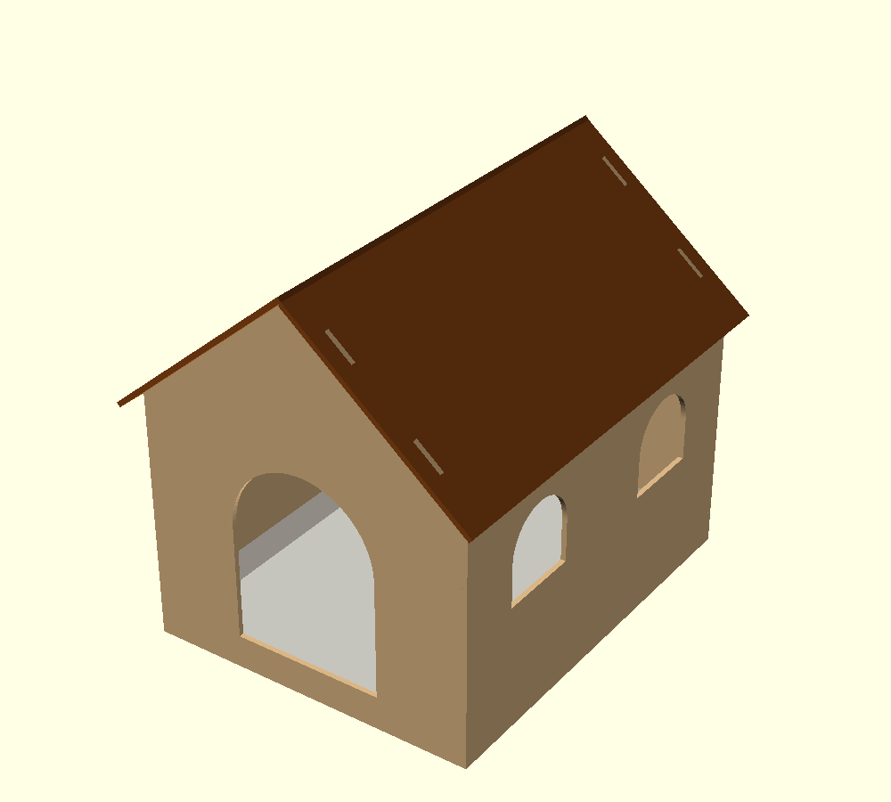
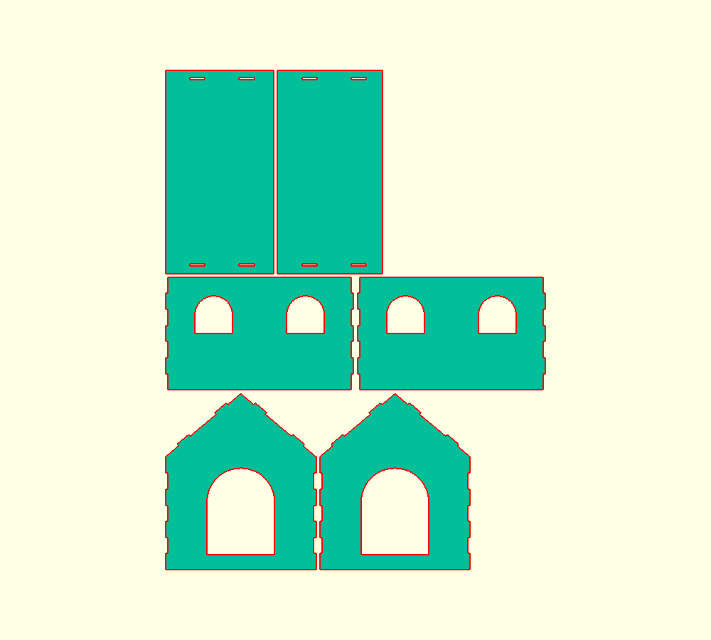
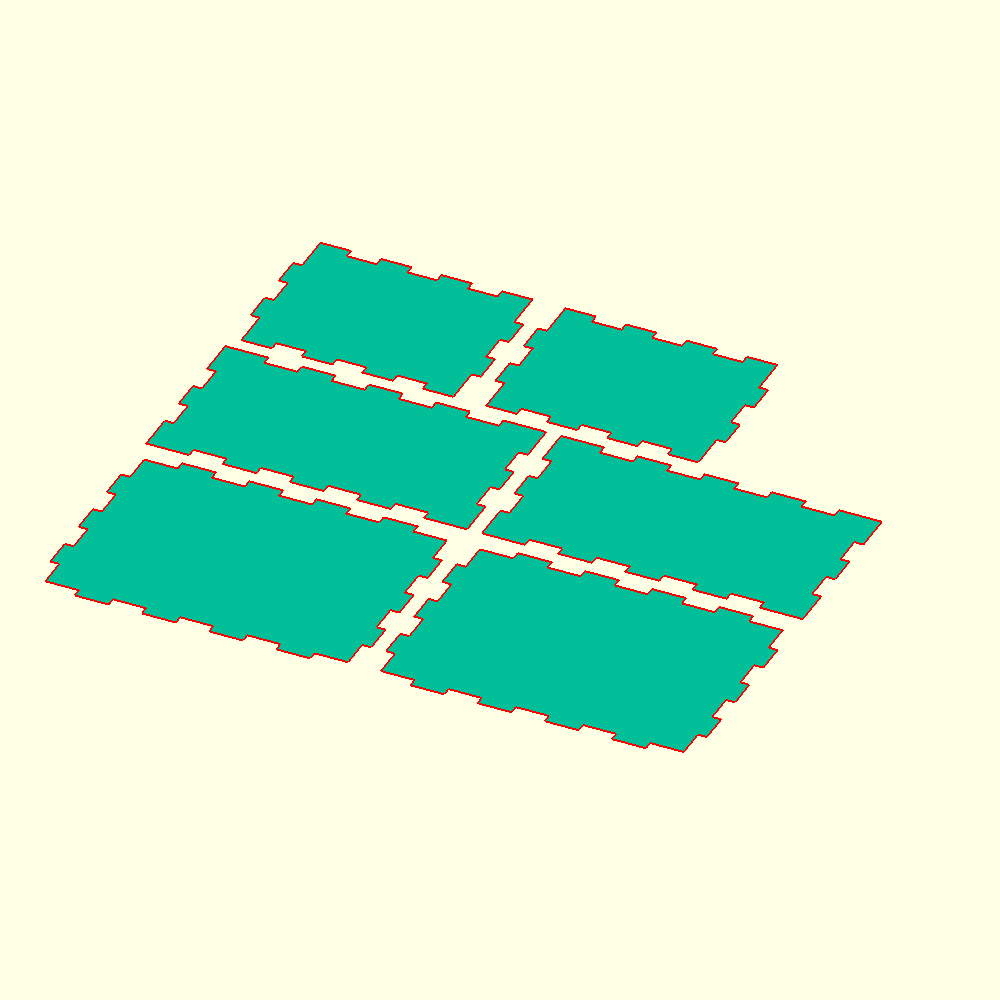

# laser-box

Parametric laser-cut designs for [OpenSCAD](https://openscad.org/). Change the sizes, material thickness or kerf, then export SVG/DXF for your laser.

## Designs

### Cat house — `house.scad`



A gable-roof cat house with an open bottom that sits over a cardboard scratcher.

- 6 parts: front and back walls with arched doors, two side walls with windows, and two roof panels
- Finger-jointed corners, and roof tabs that go through slots in the roof panels. Everything is glued together.
- The roof panels overlap at the ridge, with lengths worked out from the pitch and material thickness
- The doors start at `scratcher_height`, so the cardboard stays in and cats step up onto it
- **Two modes:** `flat` (cut layout) and `assembled` (3D preview)



### Finger-joint box — `box.scad`



A box with 6 panels, finger joints on every edge and an optional open top. Sizes can be inner or outer dimensions.

## Usage

1. Open a `.scad` file in OpenSCAD and turn on **Window → Customizer**.
2. Set your dimensions, `thickness` (measure your real sheet) and `kerf`.
3. Render with **F6**, then use **File → Export → SVG** or **DXF**.

From the command line (on Windows, use `openscad.com` to get console output):

```sh
openscad -o house.svg -D house_width=350 -D thickness=6 house.scad
openscad -o house.png -D 'mode="assembled"' house.scad
```

Use `part` to export a single panel when the full layout won't fit your laser bed.

## Tips

- **Kerf:** start at 0.1–0.2 mm and cut a test corner first. Raise it if the joints are loose, lower it if they're too tight.
- **Thickness:** "6 mm" plywood is often 5.6–6.4 mm. Measure it with calipers.
- The console prints the overall size, each part's size and any fit warnings.
